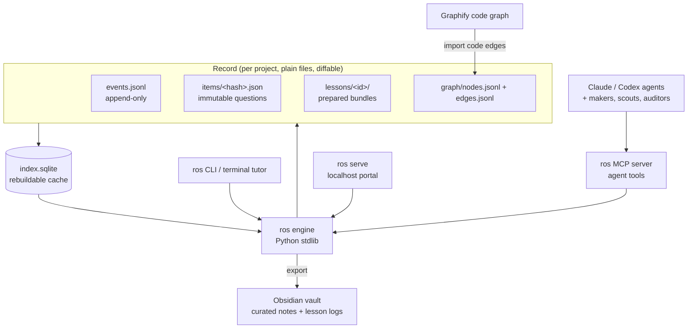
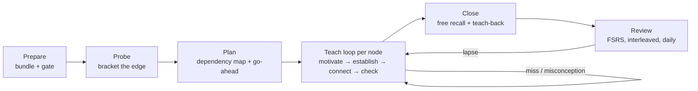
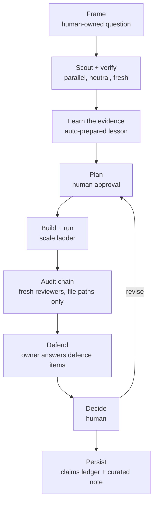

# v1.0 overhaul — one portal, one engine, prepared lessons

Status: **design proposal**, not started. Written 2026-10-21 against `p1/revision-gate` at `6e3204b`
(with 14 uncommitted files on that branch). Nothing in this document has been implemented.

Evidence tags used below:

- **[observed]**: measured in this repo or the configured vault during this review (command, file:line or screenshot)
- **[history]**: from earlier development sessions (memory records), not reproduced today
- **[inferred]**: a reasoned conclusion, not measured

## 1. Verdict in one paragraph

The system's scientific contracts (evidence, claims, retention states, fresh-context review, human approval) are
sound and worth keeping. What failed is the delivery layer around them:

- a per-session HTML/JSON/Markdown projection kept consistent by locks, journals and leases;
- a 1.8 MB runtime with one dialog per pedagogy feature;
- learner controls for decisions the tutor should make;
- strict cross-validation that refuses plans when any binding drifts;
- three Markdown re-parsers standing in for a graph store.

The inspiration system does the core loop (probe → plan → teach, with verified visuals) in about 440 lines of
instructions. The overhaul keeps our advanced features (voice, animation, pedagogy, research integrity) but puts them
on a small core:

- **one append-only event log per project**, with a rebuildable graph index;
- **one engine**, CLI first;
- **one portal page per project or course**;
- **a preparation pipeline** that must finish before a lesson can start.

## 2. What was examined

| Source | How |
|---|---|
| This repository | Code sizes, the runtime bundle build (`assets/html-runtime/build.py`), `html_sessions.py`, the pedagogy modules, docs, troubleshooting, tests and gates. |
| The vault | 18 sessions, measured. One session viewed in a browser at 1280 px and 420 px. Read-only `html_sessions.py validate` (it returned `[]`). |
| Video `kzcI5F4tGiU`, "How I Use AI to Learn Things" (Eero Alvar, 2026-08-14) | **The video itself was not watched.** YouTube refused the caption API, so no transcript was available. The chapters (Probe 10:12, Plan 12:07, Teach 13:04, Close 17:54) and the linked repo [`amosblomqvist/learn`](https://github.com/amosblomqvist/learn) were read in full. The repo has no licence, so its ideas are adopted and its text is not copied. |
| [`wanshuiyin/Auto-claude-code-research-in-sleep`](https://github.com/wanshuiyin/Auto-claude-code-research-in-sleep) (ARIS) | MIT licence. Agent guide plus the research-wiki, result-to-claim, kill-argument, experiment-audit and meta-optimize skills. |
| [`Imbad0202/academic-research-skills`](https://github.com/Imbad0202/academic-research-skills) (ARS) | CC BY-NC 4.0, so patterns only and no text. Read: POSITIONING, the collaboration-depth agent, the AI research failure-mode checklist and the commitment-ledger example. |

## 3. Diagnosis

### 3.1 Broken

| # | Finding | Tag |
|---|---|---|
| B1 | At 420 px the "Continue to your handout" button is drawn over the footer status line ("Progre… progress before closing"). Seen in standalone mode (page served outside Obsidian); not checked inside the plugin. | [observed] screenshot |
| B2 | Page title "Standard error and estimator variability" vs heading "Estimator bias and mean squared error": the file and its content disagree. | [observed] |
| B3 | A standalone page keeps progress only in the open tab: "Progress recorded in this page only. Download progress before closing." Closing the tab loses answers. | [observed] |
| B4 | The lecture board opens on "Press Start". **No session's state carries a prepared narration track.** Audio exists only as 167 sentence clips in the live TTS worker cache (`.research-os/voice/tts/cache`), synthesized on demand during sessions. | [observed] |
| B5 | Plans are refused when any cross-binding drifts. Examples: a claim locator that must match a bound source snapshot, revision chains on answered questions, board-position message validation, step-state mismatch. This is what "questions break easily" means mechanically. | [history] obs 4693, 4424, 4298, 4419 |
| B6 | Browser gates `html-browser-e2e` and `html-live-voice-browser` fail, and also failed on old `main`. | [history] |
| B7 | "Ask the tutor" existed only in the lecture stage until today's fix. Features regress because each stage builds its own controls. | [history] obs 4722–4726 |

### 3.2 Inefficient

| # | Finding | Tag |
|---|---|---|
| I1 | **Size.** About 29k lines of Python in 70 scripts, about 457 KB in 21 runtime source modules besides the `session.js` bundle (5.8k dense lines), about 33k lines of tests in 195 files, about 8.4k lines across 50 reference protocols, plus 59 per-slice gate JSON records (3.4k lines). The inspiration does the core loop in about 440 lines of Markdown and about 2.7k lines of TypeScript. | [observed] |
| I2 | **Page weight.** Every session page loads `session.js` (732 KB, bundling KaTeX) and `session.css` (1.1 MB, with 17 base64-embedded fonts plus KaTeX). The Obsidian plugin rebuilds the page into `srcdoc` on each render (`extensions/obsidian-html/main.js:766-767`). | [observed] |
| I3 | **Files per session.** Each session is 5 files (`.md` bridge, `.html` projection, `.state.json`, `.board-position.json`, `.supervision.json`). The `.research-os` folder is 94 MB: 39 MB of backups, 31 MB of voice, 22 MB of runtime. | [observed] |
| I4 | **Graphs.** Three separate `discover()` functions re-parse vault Markdown with a hand-written YAML subset on every call (`knowledge.py:420`, `research.py:733`, `ontology.py:132`). The research graph is "computed, never stored". Context receipts go `CONTEXT_STALE` and need a manual `preflight`. Graphify's code graph is not linked to claims or capabilities. | [observed] |
| I5 | **Agent loop.** The agent holds a lease and polls `html_sessions.py wait`. When no agent holds a lease the page says "tutor is not connected" and free answers sit unreviewed. | [observed] `docs/TROUBLESHOOTING.md` |
| I6 | **Release process.** A full gate takes about 40 minutes, with one gate JSON per slice (59 files observed). Process cost now exceeds feature cost. | [history] duration; [observed] file count |
| I7 | **Disclaimer text.** Learner-facing prose carries epistemic disclaimers, for example "Preparation/source labels are not independent scientific verification or research approval" in the Bloom dialog (`bloom.js`). That is status metadata rendered as reading load. | [observed] |

### 3.3 Too many learner controls

There are about **85 distinct button labels** across the runtime modules [observed]. Each P1 behaviour has its own
launcher, dialog, close button and selector: Bloom challenges, Practice tiers, Explanation levels, Teaching roles,
Study advice, Study preferences, Reasoning help, Analogy and limits, Prepared Editor critique, source comparison and
revision switches.

The tutor should make these decisions from assessment data. Asking the learner to choose "a cognitive activity" or
"a teaching role" is overhead, not pedagogy.

### 3.4 Fragile or vulnerable

| # | Finding | Tag |
|---|---|---|
| V1 | **Multi-file consistency.** Bridge, projection and state can diverge. Recovery needs `recover`, `import`, `refresh-projection` and manual removal of abandoned locks. Nine of the troubleshooting entries exist only because of this design. | [observed] |
| V2 | **Duplicated vocabularies.** Revision families and uniqueness lists exist in Python, the browser runtime and the Obsidian plugin, and drift between them. | [history] obs 4652 |
| V3 | **Desktop Obsidian only.** The custom plugin is desktop only, and there is no mobile or terminal path to an interactive lesson. | [observed] |
| V4 | **Security baseline is adequate.** The session iframe uses `sandbox="allow-scripts"` (opaque origin) and the HTML is sanitized (`main.js:764-766`). The video pane uses a separate partition with `nodeIntegration=no`. **Residual risk:** lessons may load executable `module` resources (`html_sessions.py:592-606`), and Manim scenes are code. Both are code-execution surfaces for agent-written content. | [observed] |

### 3.5 Underused

| Capability | Use so far | Tag |
|---|---|---|
| ManimGX / Manim Community (`animate.py` supports both) | 0 rendered animations in the vault | [observed] |
| Pre-rendered voice (Kokoro EN, Chatterbox TR) | 0 sessions with a prepared narration track; only a live-synthesis cache | [observed] |
| YouTube clips (`_video_records`) | 2 of 18 sessions | [observed] |
| Graph data (capabilities, prerequisites, claims) | Rendered as Mermaid. Not used as the scheduler's or planner's database. | [inferred] |
| FSRS scheduling (`fsrs_schedule.py`) | Implemented, but there is no daily review surface that pulls due items across lessons. | [inferred] |

## 4. Design principles

1. **One record, many views.** An append-only event log and immutable content items are the record. Everything else
   (SQLite index, portal, Markdown mirror, Obsidian notes) is derived and can be regenerated. No view is ever
   "repaired".
2. **One writer.** A single `ros` process owns writes for a project. No cross-process locks, leases or journals.
3. **CLI first, portal second.** Every learning and research action works in a terminal. The portal is a thin view
   over the same engine.
4. **Prepare, then teach.** A lesson cannot start until its bundle passes the readiness gate (§6.2). Live time is
   spent on the learner, not on generating assets.
5. **The tutor decides; the learner learns.** Adaptation (level, mode, hints, practice tier, analogies, review
   timing) is policy driven by evidence. The learner has at most 6 controls.
6. **Immutable questions.** Items are content-addressed. Edits create new items. Plans only order items, so no edit
   can invalidate an answer.
7. **Free means free.** Open answers are plain text, or speech, in the learner's words. Rubrics are hidden grader
   inputs, never a form the learner fills in.
8. **Claims you can defend.** In research, the agents do the work fast. A claim is only "owned" once the researcher
   passes its defence questions, which come from the same learning engine.

## 5. Target architecture

### 5.1 Data layer: record plus index

- **Where it lives.** Each project or course has one record folder. Its location is decision 5 in §13; the
  recommended default is outside the vault, with only curated notes exported to Obsidian. A research project
  keeps claims, evidence and run manifests in its Git repository (`<repo>/.ros/`), which the vault project points
  to. This keeps the existing rule: evidence lives with the code, understanding lives in the vault.
- **Sync.** Obsidian Sync is off and the vault is not under OneDrive [observed]. JSONL is still chosen over a
  database file as the record, because it is diffable, Git-friendly, sync-safe and survives partial writes line by
  line.
- **`events.jsonl`.** One line per fact, with fields `ts`, `actor`, `type`, `subject` and `data`. Types include:
  - learning: `attempt`, `grade`, `ask`, `answer`, `lesson.start`, `lesson.close`, `review.due`;
  - research: `claim.status`, `decision`, `approval`.
- **`items/<sha256>.json`.** An immutable question: `kind`, `prompt`, `answer` or hidden `rubric`, `explanation`,
  `concepts[]`, `difficulty`, and `supersedes` when it replaces another item.
- **`graph/`.** Nodes (`concept`, `capability`, `course`, `goal`, `paper`, `claim`, `experiment`, `decision`,
  `code-symbol`) and typed edges (`requires`, `teaches`, `tests`, `supports`, `invalidates`, `implements`, `cites`,
  `supersedes`). ARIS's `edges.jsonl` uses the same shape.
- **`index.sqlite`.** A cache that is rebuilt incrementally from the files and can always be deleted. It replaces the
  three `discover()` parsers and the context receipts.
  - It answers: frontier, due reviews, prerequisite gaps, "what supports claim X", "what code implements claim X",
    and mastery per capability.
  - Existing frontmatter learning records and research records are read by importers. Afterwards new facts are
    written as events, and Obsidian notes are exported views.

### 5.2 Engine: one Python package, standard library

| Module | Responsibility | Budget (lines) |
|---|---|---|
| `store` | Append and read events, put and get items, rebuild index, migrations | 600 |
| `graph` | Queries: frontier, prerequisites, claim support, code links (Graphify import) | 700 |
| `learn.probe` | Bracketed edge-finding: floor and ceiling per strand, binary-search difficulty | 400 |
| `learn.policy` | Automatic adaptation: mode, level, hints, practice tier, interleaving, when to stop | 600 |
| `learn.schedule` | FSRS, kept from `fsrs_schedule.py` | 300 |
| `prepare` | Bundle build and readiness gate; drives makers, TTS, Manim and video scout through agents and subprocesses | 900 |
| `research` | Claims ledger, verdict states, audit chain bookkeeping, approvals, defence bridge | 900 |
| `serve` | Localhost HTTP plus server-sent events; the single writer | 400 |
| `mcp` | Agent tool surface over stdio | 400 |
| `cli` | `ros learn`, `ros review`, `ros prepare`, `ros research`, `ros status`, `ros export` | 500 |
| `export` | Obsidian notes and lesson logs (Markdown with LaTeX), static read-only portal snapshot | 400 |
| **New core total** |  | **about 6.1k** |
| *Carried over* | `speech_text.py` 640, `voice.py` 1,096, `voice_adapter.py` 797, `animate.py` 576, `fsrs_schedule.py` 266 (folded into `learn.schedule`), `paper_library.py` 545, `scout.py` 380, `literature_check.py` 481, `scientific_tools.py` 240, `computational_manifest.py` 102 | **about 4.9k** (measured today; trimmed where they touch the old session layer) |
| **Engine total** |  | **about 11k** (vs about 29k today) |

**Process model.** The MCP server is started by Claude Code or Codex for the project and also runs `serve` in a
thread. The CLI talks to the running server when one exists; otherwise it becomes the single writer itself. There
are no leases. "Tutor not connected" becomes a queue, with a stated wait.

### 5.3 Interfaces

- **Terminal (full path).** The agent teaches in the terminal. Questions go through a quiz tool with instant
  feedback, and the lesson is mirrored to a Markdown lesson log so math and visuals render in any Markdown viewer.
  This is the `learn` repo's md-log pattern, adapted. Where the log lives follows decision 5 in §13.
- **Portal.** One page per project or course, at `http://127.0.0.1:<port>/p/<project>` (layout in §8). It can open
  in any browser or in Obsidian's built-in Web Viewer (a core plugin, currently off), so the custom 1.3k-line plugin
  is not needed.
- **Static snapshot.** `ros export --static` writes a read-only single HTML file for sharing or archiving. It says it
  is read-only, and never pretends to save.

### 5.4 Skills and agents

Today there are 19 skills, 14 agents and 50 protocols. The target is 6 skills, 6 agents and about 8 canonical
references.

| New skill | Absorbs |
|---|---|
| `learn` | `tutor`, `course-study`, `derive`, `study-source` (as modes); probe → plan → teach → close |
| `prepare` | `science-visualize`, animation, voice and the video scout; builds and gates lesson bundles |
| `research` | `research-session`, `form-hypothesis`, `design-experiment`; `geant4`, `ml-experiment` and `qml-experiment` become method lenses |
| `audit` | `stats-audit`, `physics-audit`, `chemistry-audit`, `biology-audit`, `research-review`; domain = lens file loaded on demand |
| `defend` | `defend-research`, `code-walkthrough`; ownership and defence practice |
| `notes-to-latex` | Unchanged (standalone utility) |

| New agent | Role |
|---|---|
| `scout` | Neutral literature and web discovery (the `learn` researcher pattern plus our neutrality rules) |
| `verifier` | Source verification with exact locators, in a fresh context |
| `auditor` | Fresh-context reviewer, given file paths only, parameterized by lens (stats, physics, ML, QML, simulation, chemistry, biology, reproducibility) |
| `adversary` | Kill-argument: strongest rejection memo, then point-by-point defence and adjudication |
| `visual-maker` | Mermaid, SVG and Manim authoring with a render → look → fix loop. Returns one file or `NONE`. |
| `video-scout` | Finds YouTube segments; verifies them against the transcript; returns `{url, start, end, why}` or `NONE` |

The 50 protocol files collapse to: `TEACHING.md`, `PREPARATION.md`, `RESEARCH.md`, `EVIDENCE.md`, `DATA_MODEL.md`,
`PORTAL.md`, `VOICE.md` and `SAFETY.md`. Version records (`V0.x_IMPLEMENTATION.md`, gate JSONs) move to
`docs/history/`.

## 6. Learning cycle

### 6.1 Lifecycle

1. **Prepare (before the session, unattended).** The agent drafts the dependency map for the topic: unconditional
   truths at the roots, the goal as the sink. A `scout` checks the field first. `prepare` builds the bundle (§6.2).
   The learner is not involved and there is nothing to wait on live.
2. **Probe (live).** Prepared items, chosen by `learn.probe`, bracket each strand the lesson rests on. Each strand
   needs a floor (an item answered right) and a ceiling (an item missed). After a right answer the difficulty jumps
   up sharply; after a miss it narrows. A miss is characterized before teaching: slip, gap or misconception. The
   learner's goal is asked once, in free text.
3. **Plan (live, short).** The tutor shows the approach in a few sentences plus the dependency map, then waits for
   one "go". The map is pruned to the probed edge, so nothing the learner already holds is re-taught.
4. **Teach (live).** For each node: **motivate** (why we need it now), **establish** (a Socratic attempt when the
   learner can plausibly discover it, otherwise expository "how could I have discovered this"), **connect** (draw the
   edge to nodes already held), **check** (a quick item). Prepared narration plays segment by segment with its
   visual, animation or clip. Live generation is limited to answering questions and grading.
5. **Close.** Free recall with nothing shown ("explain X in your own words"), plus one transfer item. Every missed
   node becomes a review item.
6. **Review (between sessions).** FSRS schedules items across all lessons of the project. Reviews interleave topics
   and lead with retrieval before any re-explanation. Each lapse reopens that node's teach loop with a new
   explanation path.

### 6.2 Preparation pipeline and readiness gate

| Component | Produced by | Gate condition |
|---|---|---|
| Narrative script per node | `learn` agent from the dependency map, plus `scout` check | Every factual claim has a source locator or is marked as derivation |
| Voice | `voice` (Kokoro EN, Chatterbox TR; `speech_text` formula speaking) | **100% of script segments have audio.** Spoken formulas pass `speech_text` (refused spans rewritten). |
| Static visuals | `visual-maker` (Mermaid, SVG, matplotlib) | Rendered PNG/SVG, looked at by the maker, `RESULT` file present; at most about 7 elements |
| Animations | `visual-maker` with ManimGX or Manim Community via `animate.py` | MP4, poster and key-frame strip present; key frames looked at; motion has a stated basis (equation, model, data). Required for every node whose idea is change over time, geometry in motion, a limit or a distribution building up. |
| Existing videos | `video-scout` | Segment start and end verified against the transcript; licence and embed allowed; at most 1 clip of ≤3 minutes per node; **optional, never the only path**. A clip whose transcript cannot be fetched is left out, never embedded unverified. |
| Items | `learn` agent | Items for probe (at least 3 difficulty levels per strand), check (per node), close and review. MCQ options built by mutating the correct claim, with no justification inside options. Every math string renders in KaTeX (checked in Node at build time). |
| Bundle manifest | `prepare` | Hashes of all of the above; `ready: true` only when every row passes |

`ros learn <topic>` refuses to start an unready bundle and lists what is missing. A lapse found during review
re-enters `prepare` for that node only.

### 6.3 Automatic adaptation: what the tutor decides

| Decision | Inputs | Replaces learner control |
|---|---|---|
| Socratic vs expository per node | probe result, recent accuracy, response latency, "I don't know" rate | Teaching roles |
| Explanation depth (intuitive, intermediate, formal) | mastery of prerequisites, goal | Explanation levels |
| Hint escalation (cue → structure → partial step) | wrong attempt on the same item | Reasoning help |
| Practice tier and Bloom level | mastery state of the capability | Practice tiers, Bloom challenges |
| Analogy (with its stated limits) | repeated miss on the same node | Analogy and limits |
| Source comparison | node marked contested in the graph | Source comparison |
| Review timing and mix | FSRS state | Study advice, Study preferences |

The policy is deterministic and logged (`policy` events with reasons), so it can be audited and tuned. It is not
shown to the learner as text.

**Learner controls (maximum 6):** answer field (type or speak), **I don't know**, **Ask** (free question at any
moment, in every stage), **Continue**, **Replay** (audio or animation), and a pace setting (voice speed, in
settings). The portal home adds **Review now** and **Start lesson**.

### 6.4 Questions that do not break

- **Immutable items.** An item is identified by the hash of its canonical content. An attempt records the item hash,
  so editing a question creates a new item with `supersedes`, and old attempts stay valid.
- **Plans are data.** A plan is an ordered list of item hashes plus a policy name. Changing a plan never needs a
  revision chain and is never refused because of history.
- **Validate at build, not at runtime.** Rendering, units, numeric tolerance and option parity are checked when the
  bundle is built. A broken item is excluded from the bundle with a reason; it cannot break a live lesson.
- **Kinds.** `choice` and `numeric` are graded instantly from the item. `free` is plain text or speech with no
  visible structure:
  - the hidden rubric (criteria plus common misconceptions) is grader input only;
  - grading returns a verdict, prose feedback in the tutor's voice, and misconception tags written as events.

### 6.5 Retention mechanisms, each tied to a measured signal

- **Pretesting.** Probe before teaching.
- **Generation.** Socratic attempts and free answers.
- **Dual coding.** Narration with a synchronized visual or animation.
- **Elaboration.** The connect step.
- **Retrieval practice.** Check, close and review.
- **Spacing.** FSRS.
- **Interleaving.** The review mix.
- **Corrective feedback.** Immediate for choice and numeric answers, prose for free answers.

**Success metric:** FSRS retrievability at the first review, and unaided free recall at close, per capability.
Session length or number of items done is not a success metric.

### 6.6 When no agent is attached

| What the learner does | What happens |
|---|---|
| Choice, numeric or review items | Graded immediately from the items |
| Free answer | Saved and queued with an honest note: "your tutor will read this when you next start a lesson" |
| Plays a prepared lesson | Works fully: audio, visuals and items are all in the bundle |

There is never a dead end, and never a "tutor not connected" wall.

## 7. Research cycle

### 7.1 Human touchpoints

The researcher works at four points: **Frame**, **Plan approval**, **Defend** and **Decide**. Everything between them
runs unattended and finishes as a **decision queue** in the portal's research view. Throughput comes from parallel
agents; ownership comes from the gates.

### 7.2 Integrity: adopted patterns

| Pattern | Origin | Our form |
|---|---|---|
| Six-state verdicts `PASS / WARN / FAIL / BLOCKED / ERROR / NOT_APPLICABLE` | ARIS assurance contract | Every audit writes a verdict event on a claim |
| Executor never judges its own integrity; reviewer reads artifacts cold (paths only) | ARIS | `auditor` is always a fresh context; the request carries file paths and the claim, not the author's reasoning (already our policy; now enforced by the MCP tool shape) |
| Audit chain | ARIS | 1. experiment integrity (fake ground truth, self-normalized scores, phantom results); 2. result→claim; 3. reported numbers vs runs; 4. citations; 5. kill-argument. Which ones are mandatory depends on the `assurance` level (draft, internal, presentation, submission). |
| Deterministic evidence pre-check before any model call | ARIS `result-to-claim` step 1.5 | `research` checks that every cited number exists in a named result file |
| Seven AI research failure modes | ARS (after Lu et al. 2026) | Checklist at the integrity gate: implementation bug passing self-review, hallucinated citation, hallucinated result, shortcut reliance, bug reframed as insight, methodology fabrication, early frame-lock |
| Commitment ledger | ARS | Reviewer or supervisor comments split into atomic commitments, each with required evidence and a fulfilment status |
| Research wiki with typed edges and capture hygiene | ARIS research-wiki | Our `graph/` plus a filter so transient tool failures never become durable notes |
| Two control axes: `effort` and `assurance` | ARIS | Replace scattered flags |
| Propose vs apply split for self-improvement | ARIS `meta-optimize` / `meta-apply` | Agents may propose skill or policy changes; only a human-invoked command applies them |

### 7.3 Defensibility: the bridge into the learning cycle

Every claim that reaches `PASS` on its required audits generates **defence items** in the learning engine:

- the derivation of the method;
- why this baseline;
- what would falsify the claim;
- the strongest rejection argument (from `adversary`) and its answer;
- where in the code the number comes from (via Graphify `implements` edges).

A claim's ownership state:

| State | Meaning |
|---|---|
| `unowned` | No defence items answered yet |
| `practising` | Defence items in progress |
| `owned` | Defence items passed in free recall, and still retrievable at their FSRS review |
| `waived` | The owner explicitly accepted the risk; recorded |

Presentation and submission assurance require `owned` or `waived`. Gaps become lessons automatically. This is the
system's distinctive feature: neither ARIS (autonomy-first) nor ARS (manuscript-first) teaches the researcher their
own work.

**Optional modes, taken from ARS ideas:**

- A **non-generation mode** for framing. The agent asks and mirrors but does not propose hypotheses; leaving the mode
  is explicit and labelled.
- An advisory **collaboration-depth** note per stage: delegation, vigilance, reallocation, with the turns cited. It
  never blocks.

## 8. Portal (one page per project or course)

**Layout.** One column on phones. On desktop, a 240 px left rail plus a main column with a 72-character measure.
No floating tool rail and no dialogs for core work.

| Section | Contents |
|---|---|
| **Today** | Due reviews (count, Review now), the next lesson (ready or what is missing), queued free answers awaiting the tutor |
| **Learn** | The course or project map (graph from the index; click a node for its mastery, lessons and items); the lesson player (narration, visual or animation, prompt, answer; the same 6 controls everywhere) |
| **Research** (research projects) | Decision queue, claims ledger with verdicts and ownership, runs, audit reports |
| **Library** | Lesson logs, handouts, sources, videos and visuals, searchable |
| **History** | Every attempt, grade and decision (from `events.jsonl`) |

**Visual rules:**

- One type scale and one 8 px spacing grid.
- Every button uses the same component, with a min-height of 44 px and centred text in a fixed line-height.
- No absolutely positioned footer.
- Text never overlaps at widths from 320 to 1920 px. Each release runs an automated layout check for overlap and
  overflow at 320, 768, 1280 and 1920 px.

**Budgets:**

- Portal JS ≤ 60 KB and CSS ≤ 20 KB (uncompressed, our code).
- KaTeX and fonts are shared, cached files loaded once, not inlined per page.
- First render under 300 ms locally.

## 9. Robustness: each current failure mode removed or replaced

| Today (troubleshooting entry) | Overhaul |
|---|---|
| Projection differs from state; `refresh-projection` | Removed: there is no stored projection; views are rendered from the record |
| Interrupted write; `recover` journals | Replaced: append-only JSONL lines; a torn last line is ignored on read |
| Conflicting manual bridge edit; `import` | Removed: there are no bridges; Obsidian notes are exports, and curated notes are owned by the human |
| Abandoned `.session.lock`, manual removal | Removed: single writer process |
| Tutor not connected; leases; `--takeover` | Replaced: queue with an honest wait; the prepared lesson still works |
| `CONTEXT_STALE`, `preflight` | Replaced: the index updates incrementally on every append |
| Unplaced figure or widget | Moved to the build-time gate; never reaches the learner |
| Placeholder or internal heading refused | Moved to the build-time lint |
| Plan revision refused on answered questions | Removed: immutable items plus plans as data (§6.4) |
| Locally modified installation refuses overwrite | Kept: content-hash check on install |

## 10. Keep, adapt, delete

**Keep, as code or contract:**

- `fsrs_schedule.py` and the retention states (`unknown`, `learning`, `demonstrated`, `retained`, `fragile`, `stale`);
- the EvidenceAtom and claim contracts;
- fresh-context independent review;
- explicit approval before build or run;
- the scale ladder;
- `speech_text.py` formula speaking;
- the voice adapters;
- `animate.py` backends;
- the HTML sanitizer approach;
- the paper library and neutral scouting rules;
- `notes-to-latex`;
- computational manifests.

**Adapt:**

- Learning records and research records: importers into `graph/` and `events.jsonl`.
- `scout.py` and `literature_check.py`: become `scout` and `verifier` agent tools.
- `code_walkthrough.py`: becomes `defend`.

**Delete after parity:**

- `html_sessions.py` (2.9k lines), the 11 `pedagogy_*.py` modules, the `session.js` and `session.css` bundles,
  `stages.js`, `board.js` (the blackboard is replaced by narration with synchronized visuals and animations), the
  Obsidian HTML plugin, supervision and leases, the per-session sidecars, `html_design_rollout.py`, and the per-slice
  gate JSONs.
- About two thirds of the tests, which test the removed delivery layer.

## 11. Migration plan

Build the new core alongside the old one, migrate, then delete. No big-bang cut-over.

| Phase | Work | Exit criterion |
|---|---|---|
| **M0 Decide and freeze** | Settle §13. No new features on the old runtime. | Decisions recorded |
| **M1 Record and index** | `store`, `graph`, importers for the 18 sessions (attempts, answers, reviews), frontmatter learning records, research records and EvidenceAtoms; Graphify edge import | Query parity with `knowledge.py` and `research.py` on `examples/`; all 18 sessions' attempts present in the history view |
| **M2 Terminal tutor and MCP** | `learn.probe`, `learn.policy`, `learn.schedule`, MCP tools, quiz tool, Markdown lesson log | A full STAT303 lesson (probe → close) in the terminal, with its log rendering in Obsidian |
| **M3 Preparation** | `prepare`, `visual-maker`, Manim path, voice batch rendering, `video-scout`, readiness gate | One ready bundle per course: 100% audio, every node with a looked-at visual, an animation for every dynamic node |
| **M4 Portal** | `serve`, the single page, layout checks | Budgets met; no overlap at 320–1920 px; ≤6 learner controls; accessibility audit ≥ 95 |
| **M5 Research on the core** | Claims ledger, audit chain, `adversary`, defence bridge, decision queue | One AMS ECAL QML claim taken from Frame to `owned` |
| **M6 Retire** | Delete §10 items; old session HTML exported once to read-only lesson logs; archive history docs | Repository at or below the budgets in §12 |

The release process becomes one CI suite: unit tests plus at most 6 browser journeys, under 5 minutes. Release notes
go in `CHANGELOG.md` only; no per-slice gate records.

## 12. Budgets and acceptance metrics

| Metric | Today | Target |
|---|---|---|
| Python engine | about 29k lines | ≤ 11k (≤ 6.5k new core plus about 4.9k carried over) |
| Portal code | about 1.8 MB loaded per page | ≤ 80 KB of our code plus cached KaTeX and fonts |
| Files per lesson | 5 sidecars per session | 1 bundle folder; 0 sidecars |
| Learner controls | about 85 labels | ≤ 6 in a lesson |
| Skills / agents / protocols | 19 / 14 / 50 | 6 / 6 / about 8 |
| Test suite wall time | about 40 min full gate | < 5 min |
| Lessons with prepared audio | 0 of 18 | 100% (enforced by the gate) |
| Animations rendered | 0 | Every dynamic node |
| Learning outcome | not measured | First-review retrievability and close-recall per capability, reported in the portal |

## 13. Decisions needed from you

1. **Portal host.** Recommended: a localhost page served by the `ros` process, opened in a browser or in Obsidian's
   core Web Viewer. This drops the custom plugin.
   - Alternative: keep a thin Obsidian plugin that only frames the localhost page.
2. **The `p1/revision-gate` branch** (14 uncommitted files). It deepens revision chains, which this design removes.
   Recommended: commit it to its branch as-is for the record, do not merge it, and freeze P1 work.
   - Nothing has been committed or discarded.
3. **Codex parity.** Recommended: keep it. The core is model-independent, so MCP plus skill files serve both.
   - Dropping parity would only simplify installation.
4. **The blackboard.** Recommended: retire the live handwriting board in favour of prepared narration with
   synchronized visuals and Manim animations.
   - Alternative: keep it as one optional visual type rendered at prepare time.
5. **Where the record and media live.** Your vault rules call it curated knowledge, never a raw session log.
   - Recommended: keep `events.jsonl`, items, audio and video bundles outside the vault, in
     `~/ResearchOS/projects/<name>/` (or the research repo's `.ros/`). Export only curated notes into the vault: one
     course or project note, concept notes, decisions. Lesson logs stay in the portal's Library, not in Obsidian.
   - Alternative: the `_ros/` folder inside the vault as written in §5.1. It is simpler to find, but it puts machine
     records and media into your knowledge base.

## 14. Risks

- **Re-implementation risk.** Mitigated by building alongside and by query parity tests against `examples/`.
- **Prepared-only lessons can feel rigid.** The live tutor still answers "Ask" and grades free answers. The policy
  picks among prepared alternatives per node; when none fits, it falls back to live expository text, marked as such.
- **Manim and TTS render time.** Rendering runs unattended in `prepare`, ahead of time, and is incremental per node.
- **YouTube availability and terms.** Clips are optional and never required for the gate. Embeds only; no
  video downloading.
- **Transcript fetching is a new dependency.** In this review the in-page caption API, the `timedtext` endpoint and
  `get_transcript` all refused requests. `video-scout` would need a subtitle fetcher such as `yt-dlp --write-auto-subs
  --skip-download` or the `youtube-transcript-api` package. That needs your approval before M3.
- **Executable content.** Lessons carry no executable modules (declarative widgets only). Manim scenes are rendered
  in a subprocess at prepare time, and only the video output reaches the learner.
